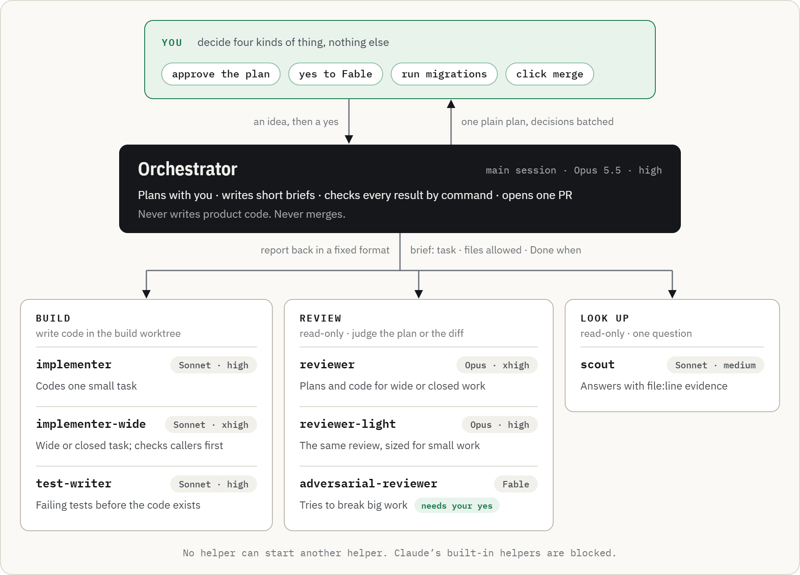
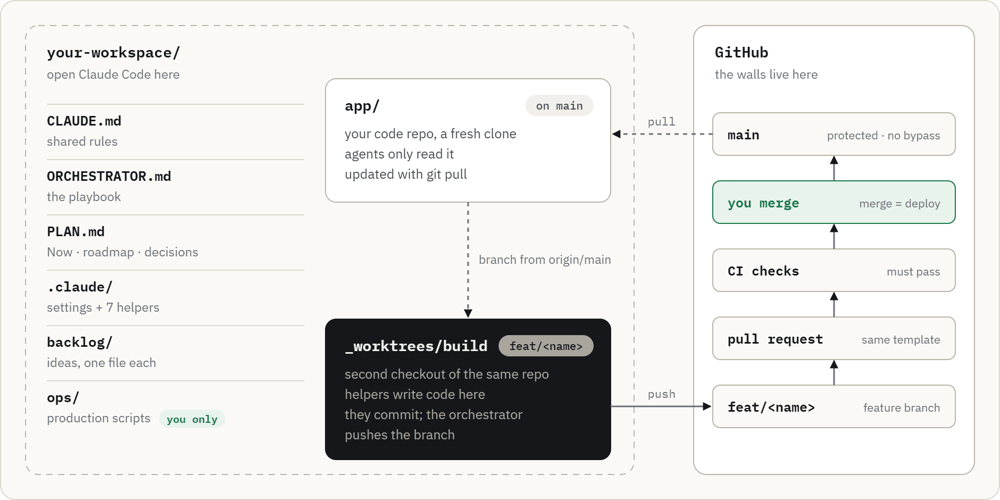

# Claude Code Orchestrator

**One Claude Code session runs the whole feature for you.** It plans with you in plain language, hands each small
task to a specialised helper, proves every change by running commands, and opens one pull request. You approve the
plan and click merge.

[Install prompt](INSTALL-PROMPT.md) · [Changelog](CHANGELOG.md) · [Project page](https://bn-basel.github.io/claude-code-orchestrator/)

## Why I built this

I built this for my own use, while developing my own product. I was working across a lot of Claude chats, and I
was the one carrying plans, reports and context between them by hand. That was slow, and it kept causing
problems: every hand-off was a chance for something to get lost or misread.

So I gave the job of the go-between to a single **orchestrator** session. It talks to me, delegates to helpers,
checks their work itself, and only comes back to me for the decisions that are really mine.

This is **version 1**. It's my personal setup, published in case it helps someone else, and it will keep changing
as my own workflow improves.

## How it works

<picture>
  <source media="(prefers-color-scheme: dark)" srcset="docs/assets/loop-dark.png">
  <source media="(prefers-color-scheme: light)" srcset="docs/assets/loop-light.png">
  
</picture>

Every task gets a label from one question: *if this goes wrong, how hard is it to undo?* **Small** work takes the
light path. **Wide** and **closed** work also gets a review of the plan and tests written before the code. Every way
back has a budget of two fixes per task and two review rounds; after that, you decide.

## The team

<picture>
  <source media="(prefers-color-scheme: dark)" srcset="docs/assets/team-dark.png">
  <source media="(prefers-color-scheme: light)" srcset="docs/assets/team-light.png">
  
</picture>

Each helper is one file in `.claude/agents/` with a fixed model and tool list. No helper can start another.

## Quick start

1. Clone this repo next to your project.
2. Open Claude Code in the folder that contains your project.
3. Paste [`INSTALL-PROMPT.md`](INSTALL-PROMPT.md), with the path to `template/` filled in.

It backs up, audits your project, adapts the rules, installs one approved step at a time, and ends with a small
trial feature. After that, start every session with:

```
You're the orchestrator. Read ORCHESTRATOR.md, then the Now section of PLAN.md, and report.
```

You need Claude Code, your code on GitHub, the `gh` command-line tool, and access to Opus and Sonnet.

## Make it yours

<picture>
  <source media="(prefers-color-scheme: dark)" srcset="docs/assets/workspace-dark.png">
  <source media="(prefers-color-scheme: light)" srcset="docs/assets/workspace-light.png">
  
</picture>

The install prompt walks you through these:

- **Fill in** the placeholders like `{{PROJECT_NAME}}`, `{{MAIN_BRANCH}}` and your test commands.
- **Decide** the spots marked `<!-- ADAPT -->`: what counts as small, wide or closed in your code, and your product rules.
- **Review** the deny list in `.claude/settings.json`, and add your own production scripts to it.
- **Keep** the core: the loop, the labels, checking by command, and one PR per feature.

No Fable access? Set `model: opus` in `adversarial-reviewer.md`. Not on Windows? Remove the `PowerShell(...)` rules.

## Long sessions

The orchestrator runs long sessions, so the template guards its context:

- **Rotate first.** After a merge, past about half the context, start a fresh session. The Now block in `PLAN.md`
  carries the state over.
- **Auto-compact at about 600k as a backup.** On 1M-context models Claude Code would otherwise wait until about
  967k. The template sets `"autoCompactWindow": 600000`; `/autocompact 600k` does the same for one model.
- **Nothing lost on compaction.** A hook prints the Now block back into the conversation right after a compaction.
- **Fresh helpers beat cold ones.** A helper's cache lasts 5 minutes, so the orchestrator resumes one only within
  that window; otherwise it starts a fresh helper with a short brief.

## Orchestrator or Projects?

Claude Code **Projects** (public beta on Pro and Max) is the built-in version of the same idea: one coordinator
conversation, one thread per task, shared instructions and memory, and threads that run in the cloud by default.

- **Use Projects** for a self-contained GitHub repo, when you're happy for the work to run in the cloud.
- **Use this orchestrator** for local work and a different model per helper. Projects can't adopt a local session,
  gives every thread the same model (all Opus by default, which uses plan limits faster), and is still a beta.

## License

[MIT](LICENSE)
