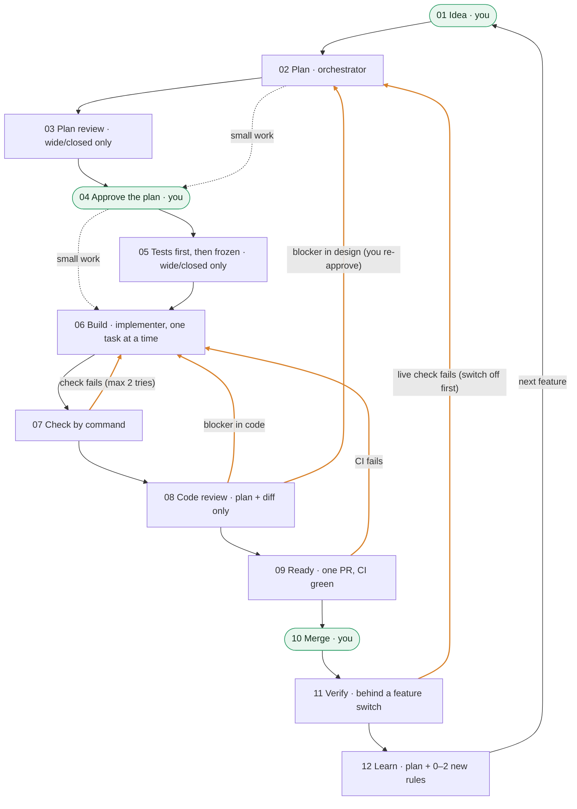

# Claude Code Orchestrator

One orchestrator plans with you in plain language, hands each small task to a specialised helper, proves every
change by command, and opens one pull request per feature. **You approve the plan and click merge.** Everything in
between runs on its own.

**[Project page](https://bn-basel.github.io/claude-code-orchestrator/)** · **[Install prompt](INSTALL-PROMPT.md)** · **[Changelog](CHANGELOG.md)**

> This is my personal Claude Code setup, built while developing my own product and published because it might help
> others. It evolves as my workflow evolves, so expect changes; the [changelog](CHANGELOG.md) records each one and
> the lesson behind it.
>
> Not an official Anthropic product.

## Four principles

1. **Decide before building.** A design check and a plan review happen before any code exists.
2. **Prove before shipping.** Checks are commands that pass or fail, not opinions.
3. **Ship so it can be undone.** Feature switches, and a "how to undo" line in every PR.
4. **Process scales with risk.** Small work gets a light process; hard-to-undo work gets the full one.

## The loop

Every task gets a **label** from one question: *if this goes wrong, how hard is it to undo?* When unsure, pick the higher one.

| | Small | Wide | Closed |
|---|---|---|---|
| Typical work | wording, a test, one function | core logic, shared code | migrations, production data, security or privacy code, new packages |
| Design check + plan review | — | ✓ | ✓, Fable offered |
| Tests first, frozen | — | ✓ | ✓ |
| Implementer | Sonnet · high | Sonnet · xhigh | you choose (usually Opus) |
| Code review | Opus · high | Opus · xhigh | Opus · xhigh, Fable offered |

**Where you come in:** approve the plan · say yes to Fable (only when asked, with a reason) · run any database
migration · click merge. The orchestrator never asks you to carry messages between chats.

## Quick start

1. Clone this repo next to your project (not inside it).
2. Open Claude Code in the folder that contains your project, in the default (ask) permission mode.
3. Paste [`INSTALL-PROMPT.md`](INSTALL-PROMPT.md), with the path to `template/` filled in.

It backs up, audits your project read-only, adapts the rules to it, installs one approved step at a time, checks the
helpers load, and finishes with a small first trial. Then start each session with:

> You're the orchestrator. Read ORCHESTRATOR.md, then the Now section of PLAN.md, and report.

**You need:** Claude Code, your code in a GitHub repo, the `gh` command-line tool, and access to Opus and Sonnet
(Fable is optional, for adversarial reviews).

## What's in the box

| File | What it's for |
|---|---|
| [`template/CLAUDE.md`](template/CLAUDE.md) | Shared rules every agent loads: where things are, what's never allowed, how work is done. |
| [`template/ORCHESTRATOR.md`](template/ORCHESTRATOR.md) | The playbook, read only by the orchestrator: the loop, who decides what, plan and brief templates. |
| [`template/PLAN.md`](template/PLAN.md) | The one living record. Its **Now** block lets any fresh session resume. |
| [`template/.claude/settings.json`](template/.claude/settings.json) | Permission rules: what runs freely, what asks first, what's always blocked. |
| [`template/.claude/agents/`](template/.claude/agents/) | The seven helpers (below). |
| [`template/code-repo/CLAUDE.md`](template/code-repo/CLAUDE.md) | Code rules, test commands and flaky tests. Goes into the code repo. |
| [`template/code-repo/.github/pull_request_template.md`](template/code-repo/.github/pull_request_template.md) | The same PR shape every time: what, why, proof, review, database, switch, risks, undo. |
| [`template/gitignore`](template/gitignore) | The workspace's `.gitignore`. |
| [`INSTALL-PROMPT.md`](INSTALL-PROMPT.md) | Installs and adapts the template; also lists every placeholder. |
| [`docs/`](docs/) | The project page, served by GitHub Pages. |

Placeholders look like `{{PROJECT_NAME}}`. Spots that need a judgement about your project are marked
`<!-- ADAPT: ... -->`. The install prompt fills both and checks none are left.

## The helpers

| Helper | Model · effort | Job |
|---|---|---|
| `implementer` | Sonnet · high | Codes one small task. |
| `implementer-wide` | Sonnet · xhigh (Opus on request) | Codes one wide or closed task, checking first what depends on the code. |
| `test-writer` | Sonnet · high | Writes the tests before the code. They must fail first, then they're frozen. |
| `reviewer` | Opus · xhigh | Reviews plans and code. Read-only. |
| `reviewer-light` | Opus · high | The same review, sized for small work. Read-only. |
| `adversarial-reviewer` | Fable | Tries to break big work: hostile input, timing, privacy, outages, undo. Read-only, only with your yes. |
| `scout` | Sonnet · medium | Answers one lookup question with file:line evidence. Read-only. |

No helper can start another helper, and Claude's built-in helpers are blocked.

## Safety, strongest first

1. **Wall: branch protection** on main. Changes only through a PR with green checks, and an empty bypass list.
2. **Wall: no production secrets on the machine.** Local env files hold fake or test values.
3. **Speed bump: deny rules.** They block pushing to main, merging, reading secrets, migrations and production scripts.
   They match command text, which is why the walls exist.
4. **Speed bump: ask rules.** A pop-up before installs, web access and edits to the rule files. They don't reliably
   stop a helper from starting.
5. **Written rule: the playbook.** Fable only after a yes in chat; nothing runs outside the approved plan; anything
   unclear means stop and report.

## License

[MIT](LICENSE). A personal setup by Basel.
