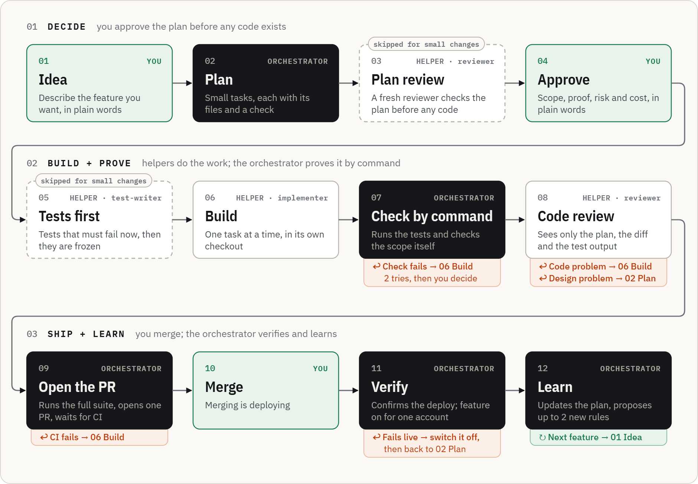

# Claude Code Orchestrator

**One Claude Code session runs the whole feature for you.** It plans with you in plain language, hands each small
task to a specialised helper, proves every change by running commands, and opens one pull request. You approve the
plan and click merge.

[Install prompt](INSTALL-PROMPT.md) · [Make it yours](#make-it-yours) · [Changelog](CHANGELOG.md) · [Project page](https://bn-basel.github.io/claude-code-orchestrator/)

## Why I built this

I built this for my own use, while developing my own product. I was working across a lot of Claude chats, and I
was the one carrying plans, reports and context between them by hand. That was slow, and it kept causing
problems: every hand-off was a chance for something to get lost or misread.

So I gave the job of the go-between to a single **orchestrator** session. It talks to me, delegates to helpers,
checks their work itself, and only comes back to me for the decisions that are really mine.

This is **version 1**. It's my personal setup, published in case it helps someone else, and it will keep changing
as my own workflow improves. The [changelog](CHANGELOG.md) records each change and the lesson behind it.

> Not an official Anthropic product.

## How it works

You start a session and describe a feature in plain words. The orchestrator doesn't jump into code. It writes a
**plan**: small tasks, each with a list of files it may touch and a *Done when* line that a command can check.
For riskier work, a fresh reviewer reads the plan before any code exists.

You get a short, plain explanation (what changes, how it's proven, what could go wrong, what it costs) and say
yes. From here it runs on its own. For risky work a **test-writer** writes the tests first; they must fail, and
then they're frozen. An **implementer** builds one task at a time in its own checkout. The orchestrator doesn't take
the helper's word for it: it **runs the checks itself**. Do the tests pass? Do the new tests fail on the old code,
proving they test something? Did only the planned files change?

Then a **reviewer** sees only the plan, the diff and the test output, never the coder's own story. Anything that
fails goes back along a defined path, with a budget: two fixes per task and two review rounds before you're asked.
When everything is green, the orchestrator opens **one pull request** with the same sections every time. You merge.
It confirms the deploy, then proposes what to learn for next time.

<picture>
  <source media="(prefers-color-scheme: dark)" srcset="docs/assets/loop-dark.png">
  <source media="(prefers-color-scheme: light)" srcset="docs/assets/loop-light.png">
  
</picture>

## The team

<picture>
  <source media="(prefers-color-scheme: dark)" srcset="docs/assets/team-dark.png">
  <source media="(prefers-color-scheme: light)" srcset="docs/assets/team-light.png">
  
</picture>

Each helper is one Markdown file in `.claude/agents/` with a fixed model, effort and tool list. None of them has
the tool to start another helper, and Claude's built-in helpers are blocked, so only these seven ever run.

## Process scales with risk

Every task gets a **label** from one question: *if this goes wrong, how hard is it to undo?* When unsure, pick the
higher one.

| | Small | Wide | Closed |
|---|---|---|---|
| Typical work | wording, a test, one function | core logic, shared code | migrations, production data, security or privacy code, new packages |
| Plan review before code | — | ✓ | ✓, Fable offered |
| Tests first, then frozen | — | ✓ | ✓ |
| Implementer | Sonnet · high | Sonnet · xhigh | you choose (usually Opus) |
| Code review | Opus · high | Opus · xhigh | Opus · xhigh, Fable offered |

## Quick start

1. Clone this repo next to your project (not inside it).
2. Open Claude Code in the folder that contains your project, in the default (ask) permission mode.
3. Paste [`INSTALL-PROMPT.md`](INSTALL-PROMPT.md), with the path to `template/` filled in.

The install prompt backs up first, audits your project read-only, adapts the rules to it, installs one approved
step at a time, checks the helpers load, and ends with a small trial feature. After that, start every session with:

```
You're the orchestrator. Read ORCHESTRATOR.md, then the Now section of PLAN.md, and report.
```

**You need:** Claude Code, your code on GitHub, the `gh` command-line tool, and access to Opus and Sonnet. Fable
is optional.

## Make it yours

The template expects a **workspace**: a folder that holds the orchestrator's files, a clean clone of your code, and
a second checkout where helpers work. Your code repo stays untouched on `main`; only the build checkout ever
changes, and only through a pull request.

<picture>
  <source media="(prefers-color-scheme: dark)" srcset="docs/assets/workspace-dark.png">
  <source media="(prefers-color-scheme: light)" srcset="docs/assets/workspace-light.png">
  
</picture>

The install prompt does all of this with you, but here's what it changes, so you know what to look at.

| | What | Where |
|---|---|---|
| **Must fill in** | 13 placeholders such as `{{PROJECT_NAME}}`, `{{MAIN_BRANCH}}` and your test commands. The full list is in the install prompt. | every template file |
| **Must decide** | Spots marked `<!-- ADAPT -->`: what counts as small, wide or closed in *your* code; your product rules; what a hostile user would try; how migrations are applied. | `ORCHESTRATOR.md`, `code-repo/CLAUDE.md`, `adversarial-reviewer.md` |
| **Should review** | The deny list (add your own production scripts by name); models and effort if your plan differs; the PR template's sections; whether merging really deploys. | `.claude/settings.json`, `.claude/agents/`, PR template |
| **Keep** | The loop, the labels, "check by command", reviewers that see only the diff, frozen tests, one PR per feature. That's the system. | — |

Common adjustments:

- **No Fable access?** Set `model: opus` in `adversarial-reviewer.md`, or delete that file and its mentions.
- **Not on Windows?** Remove the `PowerShell(...)` rules from `settings.json` and `PowerShell` from the agents' tool lists.
- **No database?** Drop the migration parts of the playbook, the PR template and the deny list.
- **Merging doesn't deploy?** Say what it does in `CLAUDE.md`; Verify then checks your release step instead.

## When something goes wrong

- **A helper fails the same check twice.** The orchestrator stops and asks you. That's the retry budget doing its job.
- **The session got long or was compacted.** Start a fresh one with the start line. The **Now** block in `PLAN.md`
  is updated at every stage, so nothing is lost.
- **Too many permission pop-ups.** Add the safe, repeated commands to the `allow` list. Never widen `deny`.
- **The orchestrator started writing code itself.** Say "stop: delegate this", and propose a rule for `CLAUDE.md` at the Learn step.

## Safety, strongest first

1. **Wall: branch protection on main.** Changes land only through a pull request with green checks, and the bypass list is empty.
2. **Wall: no production secrets on the machine.** Local env files hold fake or test values.
3. **Speed bump: deny rules.** They block pushing to main, merging, reading secrets, migrations and production scripts. They match command text, which is why the walls exist.
4. **Speed bump: ask rules.** A pop-up appears before installs, web access and edits to the rule files. Tested finding: they don't reliably stop a helper from starting.
5. **Written rule: the playbook.** Fable only after a yes in chat. Nothing runs outside the approved plan. Anything unclear means stop and report.

## Principles

- **Decide before building.** Mistakes are cheapest in the plan.
- **Prove before shipping.** A check is a command that passes or fails, not an opinion.
- **Ship so it can be undone.** Feature switches, and a "how to undo" line in every PR.
- **Process scales with risk.** Small work stays light; hard-to-undo work gets every check.

## What's in the box

| File | What it's for |
|---|---|
| [`template/CLAUDE.md`](template/CLAUDE.md) | Shared rules every agent loads: where things are, what's never allowed, how work is done. |
| [`template/ORCHESTRATOR.md`](template/ORCHESTRATOR.md) | The playbook, read only by the orchestrator: the loop, who decides what, plan and brief templates. |
| [`template/PLAN.md`](template/PLAN.md) | The one living record. Its **Now** block lets any fresh session resume. |
| [`template/.claude/settings.json`](template/.claude/settings.json) | Permission rules: what runs freely, what asks first, what's always blocked. |
| [`template/.claude/agents/`](template/.claude/agents/) | The seven helpers. |
| [`template/code-repo/`](template/code-repo/) | Code rules and the pull request template; they go into your code repo. |
| [`template/gitignore`](template/gitignore) | The workspace's `.gitignore`. |
| [`INSTALL-PROMPT.md`](INSTALL-PROMPT.md) | Installs and adapts the template, one approved step at a time. |
| [`docs/`](docs/) | The project page. `docs/assets/diagrams.html` is the editable source of the diagrams above. |

## License

[MIT](LICENSE). A personal setup by Basel, shared as is. Not an official Anthropic product.
